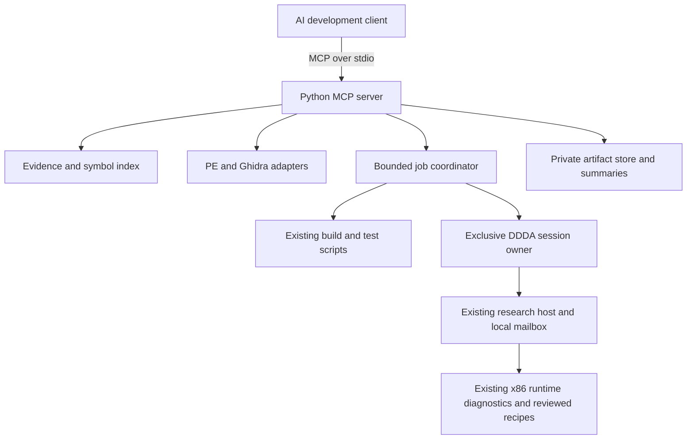

# Dragons Dogma Dark MCP — implementation plan

**Date:** 22 October 2026

**Delivery state:** version 0.3.0 implemented, including Codex registration, journaled save recovery, six reviewed recipes and paired tool-workflow benchmarks. This document retains the original design and acceptance gates; current behavior and verification are documented in [README.md](README.md), [operations](docs/OPERATIONS.md), and [validation](docs/VALIDATION.md). The native acceptance gates are not all complete. Estimates below are planning estimates, not measured delivery or speedup claims.

**Primary source:** [ddda-local-coop at `61ed1bf`](https://github.com/thingolus/ddda-local-coop/tree/61ed1bf830141b75981babe362cef42579eb98e3).

## 1. Objective and scope

Make AI-assisted DDDA development faster by turning the existing research and validation workflow into a small set of reliable, structured MCP operations. An assistant should be able to locate prior evidence, inspect the exact supported build, collect relevant runtime state, run a bounded experiment, and compare its result without repeatedly assembling shell commands and one-off Frida scripts.

The main reuse source is the current **Dragons Dogma Dark Coop / `ddda-local-coop`** project in this workspace. This interprets “current t project” as the current DDDA project. The plan targets development tooling for Dragon's Dogma 1, including investigation of its native AI; it is not a proposal to replace enemy or pawn AI wholesale.

The first release supports Windows and the existing x86 DDDA adapter. Keep the MCP process outside the game. Initial live support depends on the co-op research runtime; support for an unmodified game is a later adapter decision.

Prioritize these development loops:

1. Find the relevant function, signature, prior experiment, and known limitation.
2. Identify a build, loader, settings payload, and session before interpreting results.
3. Explain P2 input, action, menu, camera, or ownership failures using a compact snapshot and trace.
4. Run an existing regression recipe and return a structured result with evidence.
5. Build, compare, and eventually deploy a verified candidate through the existing ownership checks.

Do not make remote hosting, a vector database, a new injector, a separate gameplay runtime, arbitrary memory editing, or a new UI prerequisites for the first release.

## 2. What exists today

The committed source baseline is `61ed1bf830141b75981babe362cef42579eb98e3`. The source working tree had active, uncommitted 1.8-related work during inspection. Its current status describes live investigation on this machine; historical load failures are not a blanket statement that the current machine cannot run the game. Neither current work nor historical acceptance is automatically evidence for this new MCP.

The baseline's generated build header targets Steam build `2364871`, executable SHA-256 `19facc2642f79a09d14ce55eace5f228161f2f8bab60ec67eb3c6196cc6277b8`. It contains **216 named signature records plus three input thunks**. These are existing adapter coverage, not proof that every game system is mapped. Recompute the local executable hash before enabling a native adapter; do not rely on the filename or Steam build number alone.

The reuse inventory in [reuse-manifest.json](reuse-manifest.json) pins source paths and Git blob IDs. It inventories reusable inputs; it does not claim those files have already been ported or tested through MCP.

| Existing capability | Exact source in `ddda-local-coop` | Reuse decision / required work |
| --- | --- | --- |
| Executable inventory | `scripts/inspect_game.py` | Adapt hashing and PE metadata into a function returning structured data. Remove implicit output writes and its obsolete initial-preparation compatibility label. |
| Static bytes, strings, references, disassembly | `scripts/static_probe.py`, `scripts/member_refs.py` | Reuse `pefile` / Capstone logic. Add explicit paths, address validation, result caps, and structured records. Byte-pattern hits remain candidate references until decoded. |
| Symbol/signature knowledge | `research/symbols.csv`, `include/coop/supported_build.hpp`, `scripts/generate_runtime_manifest.py` | Build a searchable derived index. Preserve differences between the research ledger and runtime admission signatures. Do not overwrite either source. |
| Existing research context | `docs/STATUS.md`, `docs/BACKLOG.md`, `docs/ARCHITECTURE.md`, `docs/DECISIONS.md`, `research/EXP-*.md` | Index small passages with source path, commit/content hash, and evidence status. Keep historical and current claims distinguishable. |
| Guarded launch and local IPC | `scripts/research_host.py`, `scripts/research_command.py` | Adapt host checks and request correlation behind one coordinator. Remove CLI/import side effects. Do not expose the internal `evaluate` channel directly. |
| Bounded trace export | `scripts/research_export.py` | Reuse stopped-object checks, chunking, and request IDs. Return summaries plus artifact URIs instead of full traces. |
| Runtime snapshots | `include/coop/runtime_status.hpp`, `src/runtime.cpp`, `research/runtime_api.js` | Extract only the copied-value status reader. Existing `CoopStatus` is version 2 / 132 bytes; validate size and version before decoding. |
| Performance and input latency | `research/performance_status.js`, `research/observe_performance.js`, `research/observe_input_latency.js`, `scripts/collect_process_cpu.py`, `scripts/collect_process_memory.py` | Reuse existing readers/collectors. Preserve their coverage limits and exact 64-bit counters. Separate reading from starting a recording session. |
| Build and test pipeline | `scripts/Build.ps1`, `CMakeLists.txt`, `tests/` | Call the pinned Win32 build/test pipeline; parse JUnit and exit status. Build in an isolated source checkout when the active co-op checkout is busy. |
| Static reverse engineering | `scripts/Invoke-Ghidra.ps1`, `scripts/ghidra/ExportResearch.java`, `scripts/ghidra/DefineResearch.java` | Reuse local analysis and export conventions. Queue headless jobs, lock databases, cache results, and separate read exports from database-changing definitions/reimports. |
| Deployment, rollback and save backup | `scripts/deploy_runtime.py`, `scripts/Backup-Saves.ps1`, `scripts/prepare_loader_migration.py` | Adapt ownership and hash checks in the later orchestration milestone. No blind file replacement or assuming every backup script has a restore operation. |
| Both loader editions | `scripts/stage_xinput_drop_in.py`, `scripts/stage_dinput_drop_in.py`, `scripts/verify_dual_loader_release.py` | Reuse packaging checks when candidate packaging is added. Keep one runtime implementation with loader-specific receipts. |
| Established regression recipes | `scripts/validate_generic_runtime.py`, `scripts/validate_bow_slots_lifecycle.py`, `scripts/check_shared_lifecycle.py` | Register only files proven present in the pinned manifest. Start with a small curated set; inspect every recipe for side effects and required fixtures. |

The legacy host, command scripts, static helpers, and build scripts use repository-relative paths. They cannot simply be moved into a package unchanged. Introduce explicit `game_root`, `coop_source_root`, `artifact_root`, and tool paths, and make imports inert before reuse.

**Critical trap:** `research/runtime_api.js` installs a 100 ms timer and calls `CoopSetTestPads` when loaded. Loading it changes the input provider. Extract its `runtimeStatus` reader into a new definition-only adapter, with no timer and no synthetic input. Treat observation hooks and instrumentation as session operations even when they do not intentionally change gameplay.

## 3. Architecture



Use Python 3.13 as the initial host target, subject to dependency installation validation. It fits the existing Python research tools; the game runtime remains Windows x86 C++20. A 64-bit Python process may communicate through Frida; it must not try to load the 32-bit runtime DLL into itself with `ctypes`.

Use the official Python MCP SDK and **stdio** for the local first release. The official SDK documentation currently identifies v2 as its stable line and Python 3.11+ as its requirement. Pin a concrete SDK release and transitive dependencies during P0 after testing the actual client protocol compatibility; older examples using v1 `FastMCP` must not be mixed into a v2 implementation. Let the SDK handle protocol negotiation. See the [official SDK documentation](https://py.sdk.modelcontextprotocol.io/) and [server transport/logging guidance](https://modelcontextprotocol.io/docs/develop/build-server).

Keep protocol traffic on stdout and diagnostics on stderr. Capture subprocess output so build scripts cannot corrupt the MCP stream. Use a separate virtual environment: retain the co-op pins for `frida==17.19.0`, `capstone==5.0.9`, and `pefile==2024.8.26` initially, and verify compatibility before changing them.

### Session coordinator

The existing file IPC has a single `command.json` / `result.json` slot. A single MCP coordinator must serialize all live commands, including reads and trace export. A cross-process lock must cover all MCP clients on this machine and identify owner PID, process start time, session generation, and lease state.

Old research scripts do not honor a new MCP lock. Phase P2 therefore requires explicit session ownership: refuse to adopt an already controlled legacy session. Either migrate its writers to the shared coordinator or end that session through its existing owner before starting an MCP-owned one. Never start a second host or overwrite another experiment's command mailbox.

Use unique request IDs, durable operation receipts, deadlines, and session IDs. After a timeout, inspect the existing job and receipt before retrying. A timed-out mutation is `outcome_unknown` until reconciled; issuing it twice is not a recovery strategy. Long operations return an application-level `job_id`, polled through `job_status`; baseline functionality must not depend on optional MCP task support.

### Knowledge index and cache

Start with SQLite FTS5 plus ordinary metadata tables; verify FTS5 availability and fall back to bounded text search if necessary. No embeddings are required for the first release. Index approved source files and sanitized experiment summaries, not the entire game folder or private traces by default.

Cache keys include executable hash, source commit or dirty-file hash, runtime/settings hashes where relevant, adapter version, and normalized query. Return source references with every conclusion. Invalidate affected entries when these identities change. Parse evidence as data, never as executable instructions or agent policy.

## 4. MCP surface

Implement tools with typed input and output schemas, explicit bounds, and structured errors. Return a short human-readable summary alongside structured results. MCP tool annotations describe behavior; enforcement belongs in the server. Follow the [MCP tools specification](https://modelcontextprotocol.io/specification/2026-07-28/server/tools).

| Milestone | Tool | Bounded contract |
| --- | --- | --- |
| P1 | `project_status` | Source revision/dirty state, configured paths, adapter capabilities, current indexed status and limitations. No live attachment. |
| P1 | `inspect_build` | Hash and inspect the configured executable; report whether the native adapter recognizes it. No launch or injection. |
| P1 | `search_knowledge` | Query, topic/evidence filters, page size; return ranked excerpts and source references. |
| P1 | `lookup_symbol` | Name or validated RVA; return build pin, signature metadata, ABI notes and supporting experiments. |
| P1 | `inspect_binary` | Allowlisted mode: bytes, strings, candidate references, or disassembly; bounded ranges and output. Local file only. |
| P2 | `session_status` | Existing coordinator ownership, heartbeat, build identities and capabilities; never auto-attach. |
| P2 | `runtime_snapshot` | Read selected copied-value groups from an owned, guarded session; return freshness and missing capabilities. |
| P2 | `capture_trace` | Reviewed recipe ID, approved parameters, duration and byte limits; return a job and artifact receipt. |
| P2 | `compare_runs` | Two artifact IDs, compatible metric set; report changes and incompatible evidence explicitly. |
| P2 | `job_status`, `cancel_job` | Query or cancel a job owned by this coordinator; cancellation includes cleanup outcome. |
| P3 | `build_and_test` | Allowlisted source revision, Debug/Release and curated test group; return build hashes and test evidence. |
| P3 | `decompile_symbol` | Known symbol and pinned local analysis database; asynchronous export with bounded output. Never execute arbitrary post-scripts. |
| P4 | `start_session`, `stop_session` | Explicit owned session lifecycle and verified deployment pins; stop only the session started by this coordinator. |
| P4 | `run_scenario` | Reviewed scenario ID plus validated parameters and fixture ID; bounded synthetic input, observations and cleanup. |
| P4 | `prepare_deployment`, `apply_deployment`, `rollback_deployment` | Concrete file/hash manifest and receipt; apply/rollback operate only on the recorded owned files with the game closed. |

Expose context through resources such as `ddda://project/status`, `ddda://build/current`, `ddda://symbols/{name}`, and `ddda://runs/{run_id}/summary`. Resource IDs map to an allowlisted artifact catalog; they are not arbitrary filesystem paths. Pagination and metadata must still work for clients that use tools instead of browsing resources. See the [MCP resources specification](https://modelcontextprotocol.io/specification/2026-07-28/server/resources).

Do not publish one MCP tool per old script or per native export. Keep a compact, stable catalog; select reviewed recipes and status groups through enums. The initial snapshot covers what `CoopGetStatus` actually reports: session, controller roles, offline state, errors, stage, generation, and copied actor observations. Health, inventory, quest, or enemy fields require additional validated adapters; they are not implicitly available.

### Result and evidence contract

Every substantive result records:

- `schema_version`, operation/request ID, UTC capture time, duration and success/error state.
- Source commit, dirty input hashes if explicitly admitted, executable/runtime/settings hashes, and adapter version where applicable.
- Session ID, process identity and generation for live data; sample age and field availability for snapshots.
- Evidence class: `static`, `mock`, `synthetic_native`, or `physical_controller`; `passed`, `failed`, `blocked`, and `unverified` remain separate outcomes.
- Summary, metric units, bounded structured data, source references, artifact IDs, truncation/dropped-event counts, and remaining limitations.

Keep performance counters that exceed JSON's exact integer range as decimal strings. Do not label selected callback timings as whole-game CPU time or sampled presentation intervals as input-to-photon latency. Preserve error codes such as `unsupported_build`, `abi_mismatch`, `session_busy`, `stale_snapshot`, `capability_unavailable`, `timeout`, and `outcome_unknown`.

Default limits to validate during implementation: 16 KiB inline results, 100 rows per page, a 10-second read deadline, 120-second trace/scenario duration, 10 MiB trace output, and one in-flight live operation. Long stability runs require a named profile with its own bounded budget; callers cannot pass an unlimited timeout.

## 5. Live operation boundaries

These preserve the existing co-op engineering model and are implementation requirements, not extra approval steps for creating this plan.

- Default profile: file-based read-only knowledge and static analysis. A separate configured development profile enables named live operations within an already authorized development session. Avoid repeated confirmations for every snapshot or test.
- Live admission validates the executable, runtime/settings pins, ABI, offline transport guard, and native offline state. An unknown executable can be inspected as an unknown file; it cannot activate native tools.
- Reuse copied runtime status. Never dereference actor pointers from RPC or timer threads. Retain actor identity/generation checks and native callback ownership for any game-affecting work.
- Review every trace recipe for hooks, timers, writes, cleanup, and version pins. “Read-only” describes intended gameplay effect, not absence of instrumentation overhead or crash risk.
- Synthetic input has a bounded lease and publishes neutral input on completion/cancellation. Preserve the runtime's existing two-second provider expiry as a fallback. Do not bypass `developer_input` gates.
- Cancellation must stop timers, neutralize input, stop/export observers, and verify cleanup. Do not unload code with active callbacks. If cleanup cannot be verified, mark the session unusable until its owner resolves it.
- Deployment checks game-closed state and file ownership; preserve foreign proxies, backups, and original saves. Save fixtures require explicit identities and a tested restoration path. Never restore files over a running game.
- No generic `eval`, arbitrary shell, raw memory write, or native-call endpoint. Existing internal eval is accessible only through server-owned templates/recipes with parameter validation and recorded hashes.
- Local stdio is the initial boundary. Remote service authentication and permissions are a separate future design; do not open a network listener for P1–P4.

## 6. Delivery phases and acceptance gates

Effort below is an initial estimate for one experienced implementer, using the existing tools. It is not a calendar commitment or a measured AI speedup. Dependencies and unfamiliar game behavior may change it.

| Phase | Work and concrete output | Acceptance gate | Initial effort |
| --- | --- | --- | --- |
| P0: reproducible foundation | Python package, locked dependencies, config loader, SDK/client compatibility smoke test, fake backend, upstream pin verification and baseline timing harness. | Starts from a clean checkout without a game; imports do not launch processes or write to the co-op tree; unknown/missing local paths fail clearly. | 1–2 engineering days |
| P1: first useful MCP | Five file-based tools, source index, static adapter, resource summaries and provenance. | Client can find an existing issue's relevant source/evidence and inspect a supported or unknown executable without launch, attach, input, or deployment. Search results link to exact inputs. | 2–3 days |
| P2: owned observation | Coordinator, extracted read-only runtime reader, selected diagnostics, bounded trace/export, jobs and run comparison. | Two-client contention is rejected/serialized; stale mailbox/PID/ABI cases refuse safely; cancellation removes observers; a live snapshot does not publish test input. | 3–5 days |
| P3: development loop | Build/test adapter, selective regression registry, Ghidra export/cache, result comparison and evidence reports. | Reproduce a known failed/passed regression pair through MCP with pinned inputs; failures and missing native evidence remain visible. | 2–4 days |
| P4: bounded automation | Owned launch/stop, reviewed input scenarios, deployment receipts, save-fixture lifecycle and rollback. | End-to-end candidate loop and interruption recovery on disposable fixtures; both supported loader routes checked when packaging/deploying; original-state restoration verified. | 3–6 days |
| P5: optional native bridge | Only if measured IPC overhead, missing observability or Frida lifecycle limits justify it: versioned copied-state bridge and queued commands. | Demonstrated improvement over P2/P4, x86 ABI tests, bounded queue, restart/cancel/fault behavior, and no duplicated gameplay policy. | 5–10+ days, separately scoped |

P0–P1 targets useful file-based assistance in **3–5 engineering days**; P0–P2 targets useful live diagnostics in **6–10 days**. P0–P4 totals **11–20 days** before unforeseen native research. These ranges assume prerequisites and existing fixtures can be made runnable; repeat estimates after P1 using measured effort. P5 is excluded from those totals.

The critical path is **P0 → P1 → P2 → P4**. P3's offline build/Ghidra work can proceed after P1; integrate it before claiming a complete build/test/live loop. Concurrency is for independent source analysis and offline jobs. DDDA sessions, deployment, and the legacy mailbox retain one owner.

### First implementation backlog

1. **MCP-001 — package and source pin:** create `pyproject.toml`, a lockfile, config validation, and `verify_upstream`; resolve all manifest paths at the pinned commit. Reject silent drift.
2. **MCP-002 — protocol shell:** SDK lifecycle, typed errors, bounded results, stderr logging, and fake backend tests in an actual MCP client.
3. **MCP-003 — static adapter:** refactor inventory and static probe logic into inert functions, explicit paths and capped structured output.
4. **MCP-004 — knowledge index:** ingest symbols, signatures and selected documents; expose `search_knowledge` and `lookup_symbol` with evidence classes and source links.
5. **MCP-005 — read-only release gate:** run the five P1 tools through MCP and measure against the existing manual workflow.
6. **MCP-006 — session ownership:** cross-process coordination, legacy-host detection, request correlation, durable receipts, timeout reconciliation and cancellation.
7. **MCP-007 — telemetry extraction:** new no-input reader for `CoopGetStatus`; ABI checks and one additional proven status group.
8. **MCP-008 — first experiment:** curated trace recipe, bounded export, structured verifier, and before/after comparison. Expand only after this vertical slice works.

Stop extending the tool catalog when P1 can be used on real development tasks. Use the MCP to guide the next adapters instead of attempting to map the whole engine first.

## 7. Validation and measuring actual acceleration

Use meaningful tests around contracts and failure boundaries: malformed parameters, traversal/junction escape, mixed build data, ABI mismatch, dirty-source admission, stale actor generations, conflicting clients, late replies, duplicate requests, process death, trace overflow, cancellation and lost cleanup. Mock tests must not load the real game or need a private executable in CI.

Use sanitized synthetic fixtures for parsing/index/schema tests. Keep proprietary binaries and native test captures local. Optional native checks run on an explicitly selected local Windows machine with its own game installation. A hosted CI pass cannot establish gameplay acceptance.

Benchmark three representative tasks before implementation and after P1/P2/P3:

| Task | Baseline workflow | Desired MCP workflow | Measurement |
| --- | --- | --- | --- |
| Locate a known ownership/AI cancellation issue | Search source and experiment documents manually | One search plus symbol/evidence lookup | Median wall time, tool calls, input/output tokens, incorrect leads |
| Inspect a P2 menu/input failure | Assemble runtime readers, issue commands, inspect JSON/logs | Session check, typed snapshot, bounded trace | Setup time, time to useful evidence, retries, ambiguous results |
| Validate a focused fix | Build, select scripts, collect outputs, compare manually | Curated build/test and scenario recipe with comparison | Time to decision, manual commands, reproducibility, recovery failures |

Keep the same client/model, fixture, source revision, cache condition and task definition for paired comparisons; use at least five comparable repetitions and report median/range. Separate game launch/load time, build time, analysis time and model/tool overhead. Never hide failed runs from timing summaries.

Initial product targets, to validate rather than promise: **at least 50% less workflow overhead** on these repeated tasks, **at least 30% fewer exchanged tokens**, and no loss of evidence quality. Record actual end-to-end time too; tooling cannot remove native build or game-load latency. Add the optional native bridge only if measurements identify the legacy transport as a material bottleneck.

## 8. Repository and reuse management

The new checkout is a sibling of the co-op project:

```text
DDDA/
  ddda-local-coop/                 # existing project, independent active work
  Dragons Dogma Dark MCP/          # this independent Git repository
    README.md
    IMPLEMENTATION_PLAN.md
    AGENTS.md
    reuse-manifest.json
    config/local.example.json
    src/ddda_mcp/                 # proposed P0/P1 layout; not created yet
      server.py
      config.py
      adapters/
      knowledge/
      sessions/
      recipes/
    tests/                       # proposed
    private/runs/                # local, ignored
```

Start with a configurable sibling-source adapter and the pinned reuse manifest. For reproducible execution, materialize committed inputs in an isolated checkout or content-addressed local cache; do not execute whichever dirty script happens to be in the active co-op tree. A deliberate development override must record hashes of all consumed inputs and cannot be called a clean-baseline run.

Do not copy the entire co-op repository, private research folder, bundled tools, or game files into this repository. Initially reference the existing assets and adapt only the small pieces needed for P1/P2. If reusable Python helpers need to be extracted, give them explicit configuration, retain their upstream provenance and tests, and make that extraction a separate change. Keep the gameplay runtime and authoritative research ledger owned by the co-op project.

Original co-op source is MIT licensed; retain its copyright and license when code is copied. `tools.lock.json` records separate third-party provenance, including a dinput8 reference with no established top-level license and per-file review requirements for ArisenTools. Treat those as research references, not blanket permission to vendor them. This initial plan repository contains no copied runtime implementation or game assets.

Private Git holds project documentation, source, schemas and sanitized test fixtures. Ignore credentials, local configuration, game executables/DLLs, saves, dumps, logs, raw traces, Ghidra databases, tool installations and generated archives. An explicit artifact export should select and sanitize evidence; repository privacy alone is not a reason to upload the entire development machine's data.

## 9. Risks and decisions to resolve through implementation

| Risk / unresolved question | Planned response |
| --- | --- |
| Existing scripts assume a single caller and execute at import/load time | Explicit config, inert imports, reviewed recipes, one coordinator; prioritize these before live exposure. |
| Existing host is already owned by another development task | Report `session_busy`; do useful static work without commandeering it. |
| Source status and signatures evolve during implementation | Pin commits/blobs and separate dirty local observations. Refresh baseline through a reviewed manifest update. |
| Runtime exports differ by build or require developer mode | Capability discovery plus exact ABI checks; missing data stays unavailable, never zero-filled as success. |
| Native instrumentation adds latency or faults | Bounded sampling, overflow counters, cleanup receipts, regression comparisons and disabled-by-default recipes. |
| Ghidra database is absent or locked | Return an actionable local setup/lock result; reuse existing analysis, never silently reimport it. |
| Documentation evidence is stale or contradictory | Source/commit timestamps and explicit evidence classes; retrieve conflicts instead of choosing a convenient claim. |
| “Extreme” speedup is limited by build/load or new reverse engineering | Measure each component, ship useful slices early, avoid a second infrastructure rewrite. |
| A generic non-co-op DDDA backend is needed later | Keep adapter boundaries now; scope a separate backend after the initial co-op-based workflow proves useful. |

## 10. Completion criteria

The planning task is complete when this independent project contains the reviewed Markdown plan and reuse inventory, is committed, and its `main` branch is pushed to a verified private repository.

The future MCP v1 is complete when the chosen P1–P4 scope passes its gates, an AI client can complete a representative development loop through typed tools, results are tied to exact inputs, interruptions recover safely, and benchmark results show whether the intended acceleration was achieved. A server that only lists tools is not that outcome.

External technical references were checked on 22 October 2026. Pin exact package/protocol compatibility during implementation; do not infer installed versions from documentation alone.
